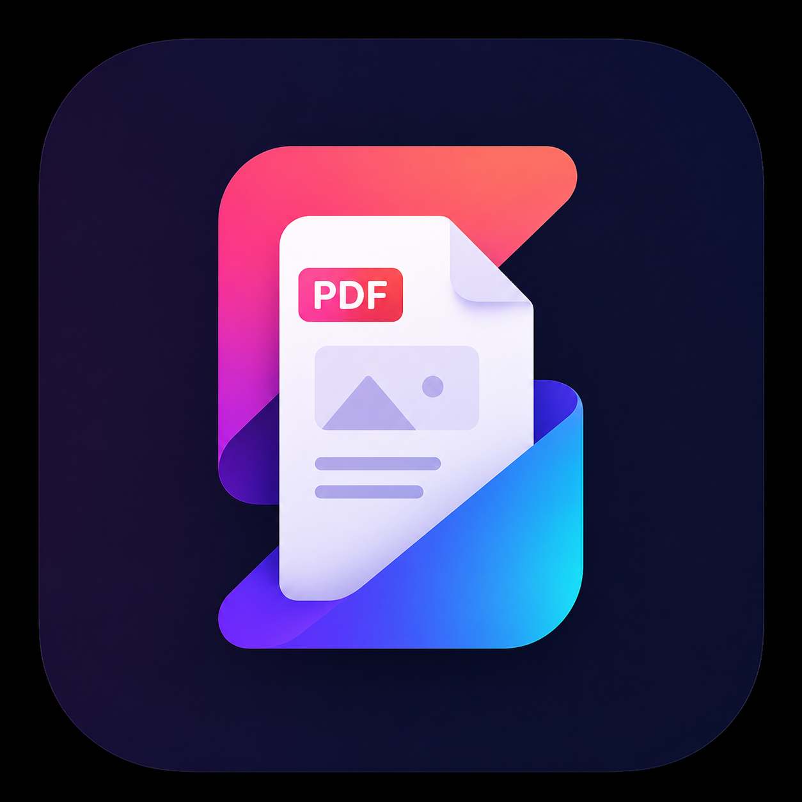

<p align="center">
  
</p>

<h1 align="center">ZenScreen</h1>

<p align="center">
  App Android de kiosk para exhibir PDFs, imágenes y videos en pantalla completa.<br/>
  Servidor WiFi integrado, panel de administración oculto y arranque automático.
</p>

<p align="center">
  
  
  
</p>

---

## ¿Para qué sirve?

Pensada para tabletas fijas en **recepciones, salas de espera, exhibiciones o puntos de información** donde se necesite mostrar contenido multimedia de forma continua y desatendida, sin que el usuario pueda salir de la app.

---

## Características

- 📄 **Slideshow de PDFs, imágenes y videos** en bucle infinito
- ⏱️ **Duración variable** — PDFs e imágenes usan el intervalo configurado; videos duran lo que dura el video
- 👆 **Toque para avanzar** manualmente (también salta videos)
- 🔒 **Modo kiosk** — bloquea Atrás, oculta barras del sistema
- 🏠 **Launcher integrado** — Home siempre vuelve al kiosk
- 🔄 **Arranque automático** al encender la tablet
- 📡 **Servidor WiFi** con autenticación — sube/elimina archivos desde el browser
- 🛠️ **Panel de administración** oculto con PIN
- 🔃 **Orientación configurable** — vertical, horizontal o automática
- 🔑 **PIN, puerto y credenciales** configurables desde la interfaz

---

## Formatos soportados

| Tipo | Extensiones |
|------|-------------|
| 📄 PDF | `.pdf` |
| 🖼️ Imagen | `.jpg` `.jpeg` `.png` `.webp` `.gif` `.bmp` |
| 🎬 Video | `.mp4` `.mkv` `.mov` `.avi` `.webm` `.3gp` |

---

## Requisitos

| Requisito | Versión mínima |
|-----------|---------------|
| Android | 8.0 (API 26) |
| Android Studio | Hedgehog 2023.1+ |
| JDK | 17 |
| Gradle | 8.4 |

---

## Instalación

### Opción A — APK directo

1. Descarga el APK desde [Releases](../../releases)
2. En la tablet: **Ajustes → Seguridad → Instalar apps desconocidas** → Permitir
3. Instala el APK
4. Abre ZenScreen — solicita permisos y abre Ajustes para establecerse como launcher

### Opción B — Compilar desde código

```bash
git clone https://github.com/tu-usuario/zenscreen.git
cd zenscreen
./gradlew assembleDebug
adb install app/build/outputs/apk/debug/app-debug.apk
```

---

## Configuración inicial (una sola vez)

### 1 · Permisos
La app los solicita automáticamente al primer arranque:
- Almacenamiento (leer archivos)
- Notificaciones (servidor WiFi en segundo plano)

### 2 · Establecer como launcher
La app abre **Ajustes → App de inicio**. Selecciona **ZenScreen** → Siempre.

> ⚠️ Sin este paso el botón Home puede salir de la app.

### 3 · Desactivar optimización de batería
Para que el servidor WiFi no sea detenido por Android:

**Ajustes → Aplicaciones → ZenScreen → Batería → Sin restricciones**

---

## Subir archivos

### Vía WiFi _(recomendado)_

1. Conecta tu PC y la tablet a la misma red WiFi
2. Entra al panel admin de la tablet (ver abajo)
3. Anota la URL en **Servidor WiFi** — ejemplo: `http://192.168.1.100:8080`
4. Abre esa URL en el browser de tu PC
5. Introduce las credenciales cuando las pida el browser
6. Arrastra o selecciona los archivos a subir (PDF, imagen o video)

**Credenciales por defecto:**
```
Usuario:    admin
Contraseña: zenscreen
```

> Se pueden cambiar desde el panel admin → Configuración avanzada.

### Vía USB / almacenamiento local

1. Conecta la tablet por USB o usa un explorador de archivos
2. Navega a: `Android/data/com.freekiosk.app/files/pdfs/`
3. Copia tus archivos ahí (PDF, imagen o video)
4. El kiosk los detecta al próximo ciclo

---

## Panel de administración

El panel es **invisible** para los usuarios — solo el administrador sabe cómo acceder.

### Cómo abrir el panel

1. **Mantén presionada** la esquina superior derecha ~3 segundos
2. Ingresa el **PIN** (por defecto: `1234`)
3. Se abre el panel

```
┌─────────────────────────[●]┐
│                             │
│   Mantén aquí 3 segundos   │
│                             │
└─────────────────────────────┘
```

### Opciones del panel

| Sección | Descripción |
|---------|-------------|
| **Servidor WiFi** | URL y credenciales para subir archivos desde PC |
| **Archivos en tablet** | Conteo por tipo (📄 PDFs · 🖼️ imágenes · 🎬 videos) + importar desde almacenamiento |
| **Intervalo slideshow** | Slider de 3 a 60 segundos (aplica a PDFs e imágenes; videos ignoran este valor) |
| **Orientación de pantalla** | Vertical / Horizontal / Auto |
| **Configuración avanzada** | Cambiar PIN, puerto del servidor y credenciales WiFi |
| **Establecer como launcher** | Abre ajustes del sistema para configurar como app de inicio |
| **Volver al kiosk** | Cierra el panel |

---

## Configuración avanzada

Todo se configura desde el panel de admin — no se requiere editar código.

| Ajuste | Dónde cambiarlo | Valor por defecto |
|--------|----------------|-------------------|
| PIN de administrador | Panel admin → 🔑 Cambiar PIN | `1234` |
| Puerto del servidor WiFi | Panel admin → 🌐 Cambiar puerto | `8080` |
| Usuario del servidor WiFi | Panel admin → 👤 Cambiar credenciales | `admin` |
| Contraseña del servidor WiFi | Panel admin → 👤 Cambiar credenciales | `zenscreen` |
| Intervalo del slideshow | Slider en el panel admin | `10` segundos |
| Orientación | Botones en el panel admin | Vertical |

---

## Bloqueo de kiosk

ZenScreen implementa tres capas sin necesidad de root ni Device Owner:

| Capa | Comportamiento |
|------|----------------|
| **Botón Atrás** | Bloqueado completamente |
| **Barras del sistema** | Ocultas — reaparecen brevemente al deslizar y se vuelven a ocultar |
| **Botón Home** | Vuelve siempre al kiosk si ZenScreen es el launcher |

> Para bloqueo total (incluyendo notificaciones) se requiere **Device Owner** vía ADB. Ver [documentación oficial](https://developer.android.com/work/dpc/build-dpc).

---

## Arquitectura

```
zenscreen/
├── app/src/main/java/com/freekiosk/app/
│   ├── MainActivity.kt          # Entry point: permisos → launcher → kiosk
│   ├── KioskActivity.kt         # Pantalla principal: slideshow PDF/imagen/video
│   ├── AdminActivity.kt         # Panel de configuración con PIN
│   ├── PinDialogFragment.kt     # Diálogo de PIN
│   ├── ServerService.kt         # Foreground service: mantiene servidor activo
│   ├── WifiServer.kt            # NanoHTTPD: dashboard HTML + API + Basic Auth
│   ├── BootReceiver.kt          # BroadcastReceiver: auto-start al encender
│   ├── PdfPageRenderer.kt       # Wrapper de Android PdfRenderer
│   ├── SlideshowManager.kt      # Navegación circular entre archivos
│   ├── FileManager.kt           # MediaType, MediaFile, listMedia(), saveMedia()
│   └── Prefs.kt                 # SharedPreferences: toda la configuración
└── app/src/main/res/
    ├── layout/                  # Layouts XML
    └── values/                  # Strings, colores, temas
```

### Flujo al encender

```
Encendido
  └── BootReceiver
        ├── Inicia ServerService  →  NanoHTTPD en puerto configurado
        └── Abre KioskActivity
              ├── Carga PDFs/imágenes/videos desde /pdfs/
              ├── PDF/Imagen  →  renderiza + timer configurable
              ├── Video       →  ExoPlayer, avanza al terminar
              ├── Toque pantalla  →  salta al siguiente
              └── Toque largo esquina  →  PIN  →  AdminActivity
```

### API del servidor WiFi

| Endpoint | Método | Auth | Descripción |
|----------|--------|------|-------------|
| `/` | GET | ✅ | Dashboard HTML |
| `/api/files` | GET | ✅ | Lista archivos con tipo e ícono en JSON |
| `/upload` | POST | ✅ | Subir PDF, imagen o video (multipart) |
| `/delete` | POST | ✅ | Eliminar archivo por nombre |

---

## Solución de problemas

### La app no arranca al encender
- Ajustes → Apps → ZenScreen → Batería → **Sin restricciones**
- Asegúrate de haber abierto la app al menos una vez manualmente después de instalar

### El servidor WiFi no es accesible desde la PC
- PC y tablet deben estar en la **misma red WiFi**
- Algunos routers tienen **aislamiento de AP** activado — desactívalo en la configuración del router
- Verifica la IP en el panel admin — puede cambiar si el router asigna IPs dinámicas

### Los archivos no aparecen después de subirlos
- Entra al panel admin y toca **Volver al kiosk** — esto fuerza el reload

### El browser pide usuario y contraseña
- Es correcto — el servidor tiene autenticación activa
- Credenciales por defecto: `admin` / `zenscreen`
- Si las cambiaste y no las recuerdas: reinstala la app para resetear a los valores por defecto

### El video no reproduce o la app se cierra
- Verifica que el formato sea soportado: `.mp4`, `.mkv`, `.mov`, `.avi`, `.webm`, `.3gp`
- Videos muy grandes pueden tardar en cargar — es normal
- Si el video está corrupto, el slideshow avanza automáticamente al siguiente archivo

### Build falla con "defined multiple times"
macOS crea duplicados al copiar/mover carpetas. Solución:
```bash
find app/build -name "* 2.*" -delete
./gradlew clean assembleDebug
```

### El toque largo no abre el PIN
- La zona sensible es la esquina **superior derecha**, área de 80×80dp
- Mantén presionado sin mover el dedo hasta que aparezca el diálogo (~3 segundos)

---

## Stack tecnológico

| Tecnología | Versión | Uso |
|-----------|---------|-----|
| Kotlin | 1.9.22 | Lenguaje principal |
| Android PdfRenderer | Built-in | Renderizado nativo de PDFs |
| ExoPlayer (Media3) | 1.3.0 | Reproducción de video |
| BitmapFactory | Built-in | Decodificación de imágenes |
| NanoHTTPD | 2.3.1 | Servidor HTTP embebido |
| Kotlinx Coroutines | 1.7.3 | Slideshow timer y renders async |
| Material Components | 1.11.0 | UI del panel admin |
| ViewBinding | — | Acceso a vistas |
| SharedPreferences | — | Persistencia de configuración |

---

## Contribuir

1. Fork del repositorio
2. Crea una rama: `git checkout -b feature/mi-mejora`
3. Commit: `git commit -m "feat: descripción del cambio"`
4. Push: `git push origin feature/mi-mejora`
5. Abre un Pull Request

---

## Licencia

MIT — libre para uso personal y comercial.
